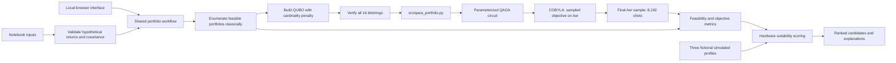

# Project Architecture

## Purpose and boundaries

QPU Sentinel is a small, notebook-first experiment that demonstrates a
reproducible QAOA workflow for a cardinality-constrained binary optimization
problem. The notebook is the primary entry point and the source of the
recorded run outputs. `src/qaoa_portfolio.py` contains the existing reusable QAOA execution routine.
`src/portfolio_workflow.py` provides shared validation, exact enumeration,
QUBO conversion, and exhaustive QUBO verification for the interface.

The current execution target is **Qiskit Aer**, a local simulator. The project
does not configure a hardware backend, hardware credentials, or a noise model.
The name QPU Sentinel describes the project; it is not evidence that a
quantum-processing unit was used.

## Repository layout

```text
.
├── notebooks/
│   └── qpu_sentinel_qaoa.ipynb   Executable walkthrough and saved outputs
├── src/
│   ├── qaoa_portfolio.py         Existing QAOA circuit and sampled optimization
│   ├── portfolio_workflow.py     Shared input validation, classical search, QUBO
│   ├── benchmark_workflow.py     Deterministic case recipes and Aer executions
│   ├── hardware_suitability.py   Compatibility checks and profile scoring
│   ├── webapp.py                 Local standard-library HTTP interface
│   └── static/                   Browser interface assets
├── tests/
│   ├── test_benchmark_workflow.py
│   ├── test_hardware_suitability.py
│   └── test_portfolio_workflow.py
├── presentation/
│   ├── slide-deck.md             Slide-ready project narrative
│   ├── QPU_Sentinel_Presentation.pptx
│   └── diagrams/
│       ├── architecture.svg      End-to-end workflow
│       └── results.svg           Recorded simulator metrics
├── submission/                  Self-contained submission copy
├── README.md                    Setup and project overview
├── ARCHITECTURE.md              This document
├── RESULTS.md                   Measured simulator results and caveats
└── requirements.txt             Tested Python dependencies
```

## Execution and data flow



The notebook runs these stages in order:

1. **Simulator smoke test:** prepare and measure a Bell state with Qiskit Aer.
2. **Input definition and validation:** define four hypothetical annual
   returns, a covariance matrix, cardinality `K = 2`, and risk aversion
   `lambda = 2.0`; check that the covariance matrix is positive
   semidefinite within tolerance.
3. **Classical reference:** enumerate the `4 choose 2 = 6` feasible
   portfolios and rank them by the objective
   `lambda * x.T @ covariance @ x - expected_returns @ x`.
4. **QUBO conversion:** add the penalty
   `(sum(x) - K)^2` and compare the converted energy with the penalized
   objective for every one of the `2^4 = 16` bitstrings.
   The workflow also reports whether the chosen penalty passes a conservative
   sufficient bound for keeping infeasible assignments above the exact
   feasible optimum; it does not silently alter a user-supplied penalty.
5. **QAOA simulation:** call `run_qaoa_portfolio` with the QUBO coefficients
   and classical optimum.
6. **Reporting:** display sampled bitstrings, feasibility, objective values,
   circuit metrics, and exact-selection sampling frequency.
7. **Suitability analysis:** evaluate the measured qubit/depth/two-qubit-gate
   requirements against fictional backend profiles. This is a scored scenario,
   not an attempt to connect to hardware.

The browser UI is an optional application layer, organized into Portfolio Lab,
Benchmark Lab, Circuit Explorer, Hardware Analysis, and Research Report tabs.
It uses Python's standard-library HTTP server, calls the shared workflow and
existing QAOA runner, and binds to `127.0.0.1` by default. Portfolio
experiments show an empty state until a run returns. Circuit and hardware
workspaces consume the latest returned run.

The UI derives each visualization from the API response:

- The selection-composition ring counts selected vs. unselected binary assets;
  it does not imply capital weights.
- The scatter plot uses the exact feasible portfolios' expected returns and
  covariance-based variances.
- The default four-asset problem has six exact feasible portfolios.
- Benchmark Lab exposes 60 deterministic recipes (four asset counts, three
  covariance structures, five replicates). Recipes are generated and executed
  on demand; only completed local-Aer results appear in its sortable table or
  summary charts. No precomputed 60-case result set is claimed.
- The comparison chart shows the exact optimum and best feasible QAOA sample
  on the same objective scale.
- The circuit explorer displays gate operations from the optimized logical
  Qiskit circuit, including measurements. Transpiled depth and two-qubit-gate
  totals are separately sourced from the Qiskit Aer execution.

Benchmark jobs run in a background thread and expose status, progress, and
completed rows through the local API. Every case is generated from a fixed
seed, enumerated classically, and run with a bounded QAOA configuration
(depth 2, 64 optimizer shots, 256 final shots, and at most 8 optimizer
iterations). Reported runtime is a measured local wall-clock duration, not a
hardware metric. A failed job is returned as failed with an explicit error;
partial completed rows remain distinguishable from a completed suite.

## QAOA implementation

`run_qaoa_portfolio` in [`src/qaoa_portfolio.py`](src/qaoa_portfolio.py):

- Validates the coefficient dimensions and positive depth and shot counts.
- Converts the linear and pairwise QUBO coefficients into `Z` and `ZZ`
  rotation terms.
- Builds a parameterized circuit with Hadamard initialization, cost layers,
  an `RX` mixer, and measurement.
- Transpiles for `AerSimulator` and minimizes the sampled QUBO energy with
  SciPy's COBYLA optimizer.
- Samples the optimized circuit, converts measured bit order to the notebook's
  asset order, and reports unique selections with their counts.
- Raises a `RuntimeError` if the final sample contains no feasible portfolio.

For the recorded run, the default experiment settings are depth `p = 2`,
1,024 shots per optimizer evaluation, 8,192 final shots, at most 80 COBYLA
iterations, and seed 42. The optimizer stopped after 39 objective
evaluations.

## Reproducibility and extensions

Use Python 3.12 and install the pinned packages in `requirements.txt`. Run the
notebook from the repository root with the `.venv` kernel selected; the
notebook imports the implementation from `src/`. See the README for exact
setup and execution commands.

This architecture is deliberately simulator-only. A future hardware study
would need an explicitly selected and documented backend, transpilation
against its target, job identifiers, backend and calibration metadata, and
careful treatment of noise and repeatability. Such a study would be separate
from the measurements reported here.

## Suitability scoring

`src/hardware_suitability.py` models three labelled fictional profiles and
compares each with the circuit requirements:

| Component | Weight |
|---|---:|
| Qubit capacity | 15% |
| Circuit-depth budget | 10% |
| Two-qubit-gate budget | 10% |
| Average two-qubit gate error | 25% |
| Average readout error | 20% |
| Direct coupling coverage | 20% |

Each component is bounded from 0 to 100. Error scores decrease linearly to a
zero score at 5% two-qubit error and 15% readout error. Resource-budget scores
decrease with the fraction consumed; capacity reaches 100 when sufficient.
Connectivity is the fraction of required interactions present as direct
couplers. Non-direct pairs can still be routable on a connected graph and are
flagged as potential routing overhead, not automatically treated as
incompatible.

Compatibility is a separate gate: enough qubits, depth and two-qubit-gate
budgets not exceeded, and a connected coupling graph when connectivity data is
available. Missing telemetry receives a neutral 50 component score and an
explicit explanation. A score ranks only these example inputs; its values
must not be interpreted as physical backend performance.

## Tests and demonstration

Run automated checks with
`python -m unittest discover -s tests -v`. The suite covers resource and
connectivity compatibility, score ordering and explanation, portfolio
validation, exact classical optimization, QUBO equivalence, and one small
QAOA-to-analyzer application run. For the student demonstration, start
`python -m src.webapp`, open `http://127.0.0.1:8000`, and follow the
presentation's input -> comparison -> profile ranking workflow.

## Scalable experiment service (current implementation)

`src/experiment_engine.py` is the source implementation for Experiment
Studio; these capabilities are not notebook-only. It generates seeded
synthetic instances for asset counts 3, 4, 5, 6, 7, 8, 9, 10, 12, 15, and
20, and accepts any cardinality from 1 through `N`. It compares the same
instance and objective using exact feasible enumeration, greedy selection,
random feasible sampling, cardinality-preserving simulated annealing, and
standard unconstrained-mixer QAOA. Each non-exact method can be repeated with
derived seeds. Records include exact candidate count, penalty sufficiency
diagnostic, QUBO verification scope, objective gap, runtime, feasibility,
optimality, selection repeatability, and QAOA transpiled resources.

The exact search evaluates `C(N,K)` candidates and rejects requests exceeding
the configured candidate limit. QUBO equivalence is checked exhaustively for
`N <= 12`; above that, 512 deterministic bitstrings are checked and the result
sets `exhaustive` to false. A sampled check is not reported as proof. QAOA
still uses a full `N`-qubit Aer simulation, and an unconstrained mixer can
produce infeasible bitstrings.

`src/experiment_store.py` stores queued, running, completed, and failed jobs,
their specifications, generated dataset IDs, and JSON results in
`results/experiments.sqlite3`. Experiment Studio submission/status/history
routes in `src/webapp.py` use this store; only one Studio job is admitted per
server process at a time. This does not yet provide cancellation, execution
deadlines, or cross-process admission control. The older 60-recipe Benchmark
Lab remains separate and in-memory; its results are not Studio records.

The eight browser workspaces are Portfolio Lab, Benchmark Lab, Experiment
Studio, Run History, Research Assistant, Circuit Explorer, Hardware Analysis,
and Research Report. Styling retains Aqua Jade `#74FFED`, Midnight Abyss
`#171F44`, and Baby Pink `#FEB1D1`.

`src/research_assistant.py` is an optional OpenAI-compatible provider client.
It assembles context from exactly one selected completed experiment, excludes
the raw covariance matrix and shot histograms, and requires explicit
external-data consent before sending the summary and question. Without
`QPU_SENTINEL_AI_API_KEY`, the API reports an unconfigured provider instead
of returning a fabricated answer. Provider transport has been exercised
against a local mock; no hosted provider, live key, or hosted response has
been tested.

The local database includes a browser-created 3-asset, cardinality-2 instance
(`seed=2026`) and a separately executed 20-asset, cardinality-10 pilot
(`seed=2030`). In the 3-asset run, exact and best-feasible QAOA selection
were both `110`; QAOA feasibility was 64.0625%, with measured transpiled
depth 7 and 3 two-qubit gates. The 20-asset run evaluated 184,756 exact
candidates, used 512 explicitly non-exhaustive QUBO checks, and recorded a
3.125% QAOA feasibility rate, depth 41, and 190 two-qubit gates. It did not
match the exact optimum. These are local simulator measurements, not hardware
results.
