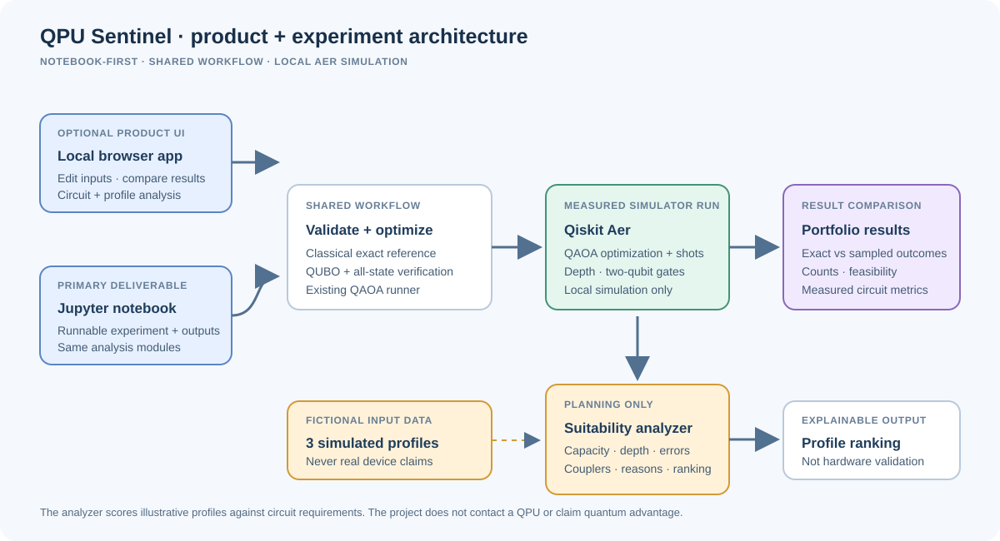
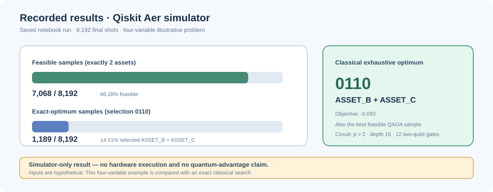

# QPU Sentinel — Fall Fest Project Brief

**A measured QAOA reference experiment and persisted research interface**

> All quantum execution shown here is local Qiskit Aer simulation. No QPU
> results or quantum-advantage claims are made. Portfolio inputs are
> hypothetical.

## Slide 1 — The project

### QPU Sentinel

**From a constrained selection problem to a measured QAOA sampling run**

- Convert a small binary optimization problem into a QUBO.
- Verify the conversion exhaustively.
- Compare a QAOA-on-simulator run to an exact classical reference.
- Run matched classical/QAOA experiments over 3-20 assets, persist completed
  records, and review them in the eight-workspace local interface.
- Keep the notebook's four-asset run as the preserved reference experiment.
- Primary executable deliverable:
  [`notebooks/qpu_sentinel_qaoa.ipynb`](../notebooks/qpu_sentinel_qaoa.ipynb)

**Speaker note:** QPU Sentinel is the project name, not a claim that a QPU
was used.

## Slide 2 — The question

Choose exactly two of four hypothetical assets while balancing expected
return against covariance-based portfolio risk:

`minimize 2.0 * x.T @ covariance @ x - expected_returns @ x`

subject to `sum(x) = 2` and `x_i in {0, 1}`.

- Four binary variables; only six feasible portfolios.
- Inputs are illustrative, not live financial data.
- Classical exhaustive search gives an exact reference at this scale.

## Slide 3 — From objective to QUBO

Add a quadratic penalty for violating the cardinality constraint:

`E(x) = 2.0 * x.T @ covariance @ x - expected_returns @ x + (sum(x) - 2)^2`

- Enumerate all 16 possible bitstrings.
- Assert that the QUBO energy equals the penalized objective for each.
- Lowest-energy configuration: `0110`.

## Slide 4 — Experiment architecture

The notebook preserves the original reference run. Experiment Studio uses
the actual Python experiment engine, matched baselines, SQLite records, and
local Aer simulation. The analyzer scores three clearly fictional profiles
against measured circuit metrics. It does not connect to hardware.

## Slide 5 — QAOA workflow

- Hadamard initialization over four qubits.
- Two parameterized cost-and-mixer layers (`p = 2`).
- COBYLA minimizes the sampled QUBO energy (39 objective evaluations).
- Aer samples the optimized circuit for 8,192 final shots.
- Report the complete bitstring distribution and feasibility rate.
- The Circuit Explorer displays the parameter-bound logical Qiskit circuit,
  gate counts, and measurements; transpiled metrics are reported separately.

**Implementation:** [`src/qaoa_portfolio.py`](../src/qaoa_portfolio.py).

## Slide 6 — Recorded results

- Exact classical optimum: `0110` (ASSET_B + ASSET_C), objective `-0.093`.
- Best feasible sampled selection: `0110`.
- Feasible shots: 7,068 / 8,192 (**86.28%**).
- Optimal selection observed: 1,189 / 8,192 (**14.51%**).
- Notebook analyzer scores: 82.17, 79.80, and 67.00 for the three fictional
  profiles (not device measurements).

## Slide 7 — What this demonstrates (and what it does not)

**Demonstrates**

- A working, saved-output Qiskit Aer notebook workflow.
- End-to-end QUBO construction with exhaustive consistency checks.
- A QAOA sample distribution that can be compared with an exact solution.
- A compact, tabbed application with data-driven portfolio charts, an
  Experiment Studio supporting 3-20 assets, exact/greedy/random/annealing/
  QAOA comparisons, persisted run history, circuit exploration, and hardware
  suitability analysis.
- A consent-gated AI research assistant that can explain a selected saved
  experiment when an OpenAI-compatible provider is configured.

**Does not demonstrate**

- Physical quantum hardware execution.
- Quantum advantage or a speedup over classical methods.
- A production-ready portfolio strategy or investment recommendation.
- A completed 60-case benchmark report. Benchmark Lab defines 60 deterministic
  recipes and executes selected cases on demand; the persisted Experiment
  Studio records are two separate pilot runs, not a completed suite.
- A live hosted AI-provider result. The assistant was checked with a local
  mock provider; no external provider is configured in this environment.

## Slide 8 — Reproduce and extend

1. Install the pinned dependencies from `requirements.txt` in Python 3.12.
2. Run `python -m src.webapp` and open `http://127.0.0.1:8000`.
3. Use **Experiment Studio** for a bounded, seeded comparison, then confirm
   the completed record in **Run History**.
4. Inspect **Circuit Explorer** and **Hardware Analysis**; no hardware is
   contacted. Optionally run a filtered recipe group in **Benchmark Lab**.
5. **Research Assistant** requires a configured provider and explicit consent
   before sending the selected experiment summary and question.
6. Open **Research Report** or the notebook for the saved reference run.
7. Future hardware work must record the backend, transpilation target, job
   identifiers, calibration context, and noise-aware evaluation.

### Likely judging questions

**Did you execute on a QPU?**  
No. The measured experiment is Qiskit Aer local simulation. There is no
hardware job or calibration data in the project.

**Do the profile scores describe IBM devices?**  
No. The three profiles and their capacities, coupling maps, and error values
are fictional inputs used to demonstrate the scoring method.

**Did QAOA outperform the classical solver?**  
No such claim is made. The classical exhaustive optimum is the reference for
this four-variable problem; the best feasible QAOA sample matched it in the
recorded simulator run.

**Are there 60 completed benchmark results?**  
No. Benchmark Lab has 60 deterministic recipes and runs selected cases on
local Aer. One 3-asset comparison and one bounded 20-asset pilot are persisted;
they are not a completed 60-case suite.

**Is the research assistant using a hosted model here?**  
No provider key is configured. The request path was tested using a local mock;
live external-provider behavior is unverified.

**Is the donut an allocation recommendation?**  
No. It visualizes binary selected vs. unselected assets. Capital weights are
not part of the current model.

**Materials:** [README](../README.md) · [Architecture](../ARCHITECTURE.md) ·
[Results](../RESULTS.md)
